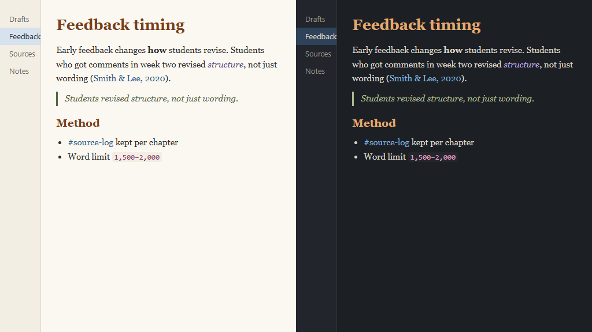

# Plagx Writer for Obsidian

**Calm light and dark themes for long-form writing in Obsidian.** Plagx Writer is made for essays, theses, research notes and journals: a readable serif text font, warm headings, quiet links and dimmed Markdown syntax.

By Plagiarism Checker X. For full plagiarism checks and AI-generated text detection, visit [Text Similarity Detector](https://plagiarismcheckerx.com/?utm_source=plagx-writer-obsidian). This free theme only changes how Obsidian looks; it does not detect plagiarism or AI-generated text.



## Features

- **Plagx Paper (light)** and **Plagx Ink (dark)**, following Obsidian's light/dark setting
- Serif reading font (Charter, Georgia) with a comfortable line height and line width
- Warm headings, italic quotes, and links that underline only on hover
- Dimmed Markdown syntax (`#`, `*`, `>`) in Live Preview and Source mode
- All text colours meet WCAG AA contrast (4.5:1 or more)
- Your own font size and font choices still apply

## Install

**From Obsidian:** Settings → Appearance → Themes → **Manage** → search for **Plagx Writer** → **Install and use**.

**Manually:** copy `theme.css` and `manifest.json` into `<your vault>/.obsidian/themes/Plagx Writer/`, then choose **Plagx Writer** in Settings → Appearance → Themes.

Switch between light and dark in Settings → Appearance → **Base color scheme**.

## Matching themes

The same colours are available for VS Code: [Plagx Writer Theme](https://marketplace.visualstudio.com/items?itemName=plagiarismcheckerx.plagx-writer-theme).

## Building from source

`theme.css` is generated from `tokens/colors.json`, which is shared with the other Plagx Writer themes:

```bash
node build.mjs
```

## License

[MIT](LICENSE) © 2026 Plagiarism Checker X
